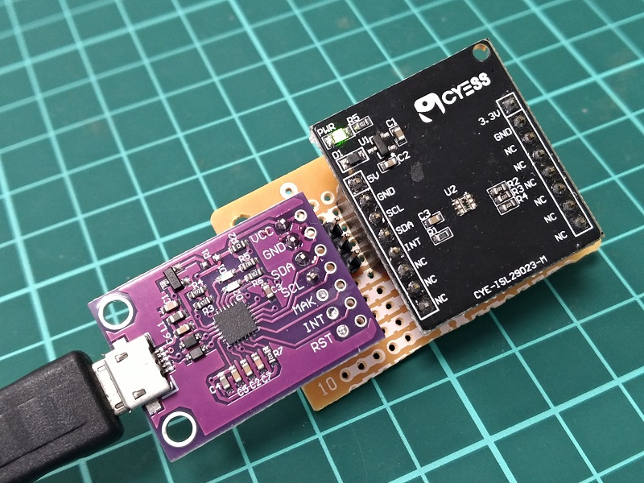
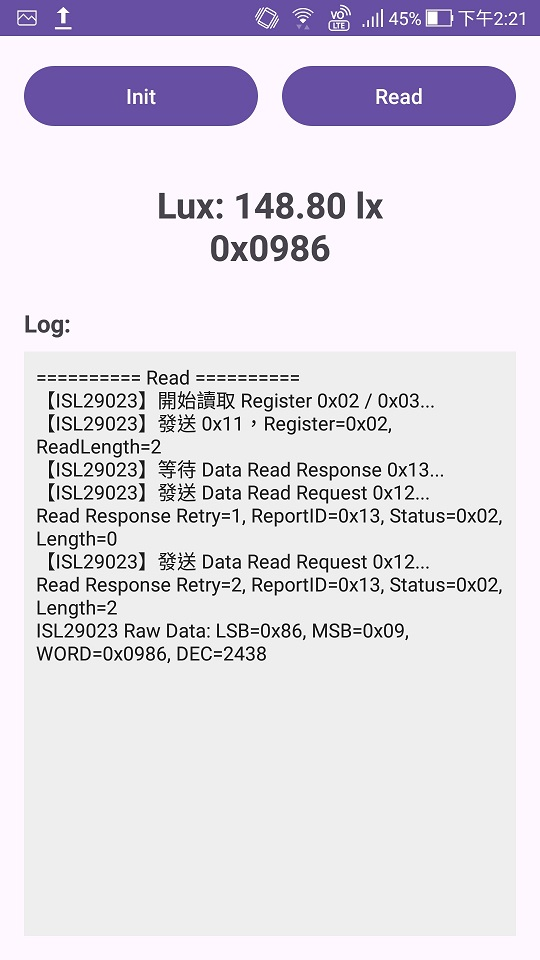
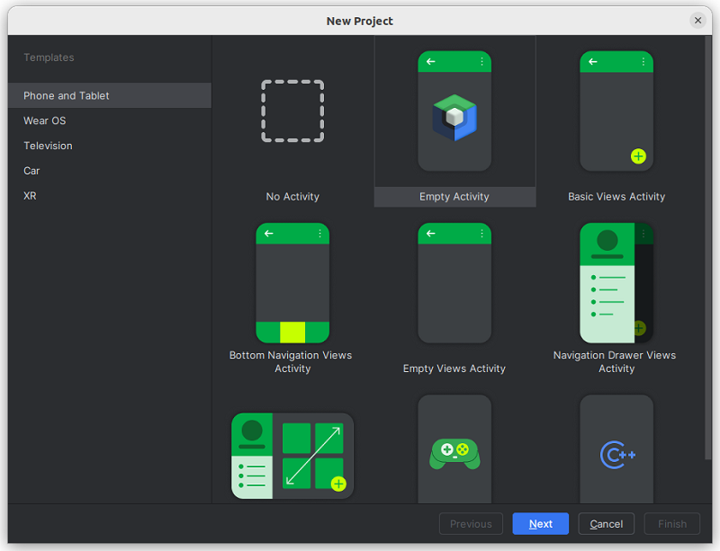
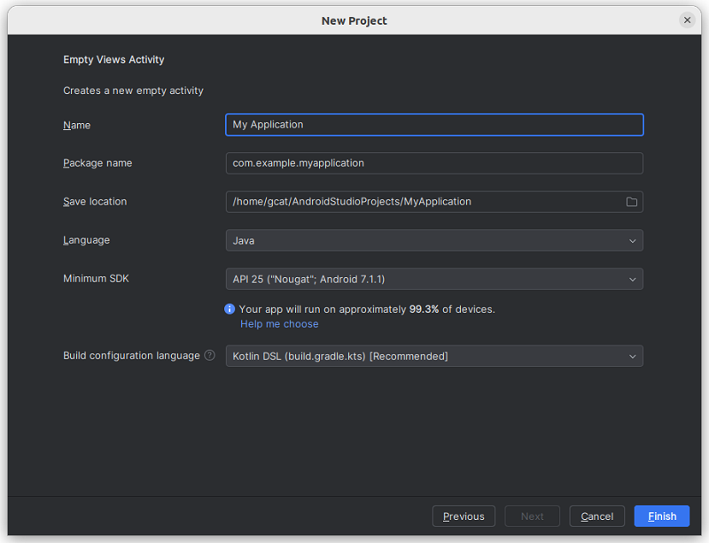

## hw
cp2112 with isl29023
 

 
 

## apk

### press button and run
basic version
 
 
 
### log
show logs
 
 
 
### auto read
auto read 
 
 
 

## how to use for android studio 
compile for yoursalf
 
 
 
Select "Enpty Views Activity"
 
 
 
